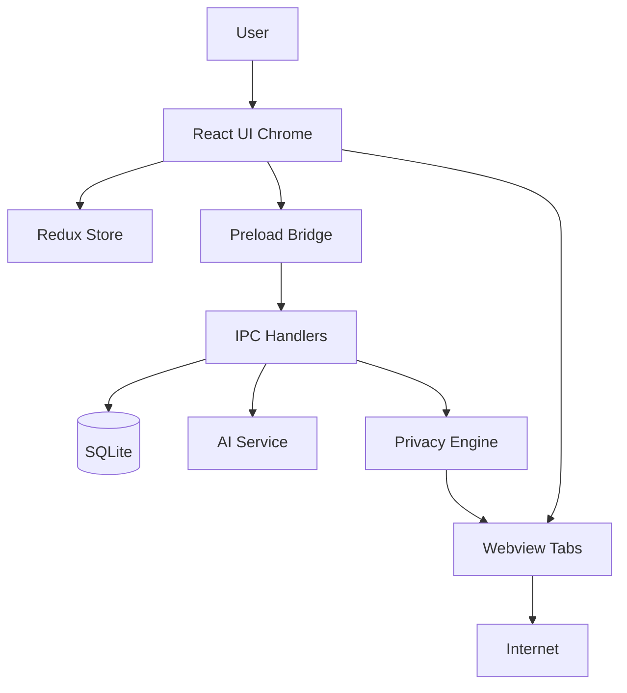
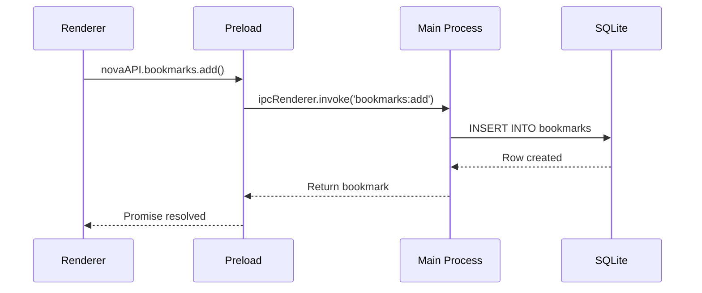
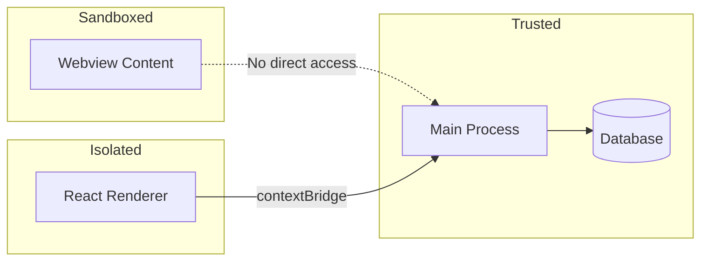

# Nova Browser — System Architecture

## Phase 1: Browser Internals Research

### 1. How Google Chrome Works Internally

Chrome is a multi-process browser built on Chromium. Key subsystems:

| Subsystem | Responsibility |
|-----------|---------------|
| **Browser Process** | UI, tabs, windows, navigation, network policy, extension management |
| **Renderer Process** | HTML/CSS/JS, layout, paint, V8 JavaScript engine |
| **GPU Process** | Compositing, WebGL, accelerated 2D canvas |
| **Network Service** | HTTP/HTTPS, QUIC, DNS, cookies, cache (out-of-process since M80) |
| **Utility Processes** | Audio, video decode, storage, profiling |

Chrome uses **Site Isolation** — each site (origin) gets its own renderer process when possible, preventing cross-site data leaks via Spectre-class attacks.

### 2. How Brave Browser Is Built

Brave is a **Chromium fork** (~2GB source). Brave modifies:

- `components/brave/` — Shields (ad/tracker blocking), wallet, VPN
- `brave/browser/` — Custom UI, preferences, onboarding
- `chromium_src/` — Patch overlays replacing Chromium files
- `adblock-rust/` — Rust-based ad blocker (replaces extension-based blocking)

Brave compiles Chromium with custom `brave_channel` branding and ships its own sync (not Google Sync).

### 3. How Chromium Works

Chromium is the open-source core. Architecture layers:

```
┌─────────────────────────────────────────┐
│  Content Layer (tabs, navigation)       │
├─────────────────────────────────────────┤
│  Blink (rendering engine) + V8 (JS)     │
├─────────────────────────────────────────┤
│  Network Stack (net/) + Skia (graphics) │
├─────────────────────────────────────────┤
│  Sandbox (OS-level process isolation)   │
├─────────────────────────────────────────┤
│  Base Libraries (base/, mojo IPC)      │
└─────────────────────────────────────────┘
```

**Mojo IPC** is Chromium's inter-process communication system using typed message pipes.

### 4. Firefox vs Chromium

| Aspect | Chromium/Blink | Firefox/Gecko |
|--------|---------------|---------------|
| Engine | Blink (WebKit fork) | Gecko |
| JS | V8 | SpiderMonkey |
| IPC | Mojo | IPDL |
| Extension API | Chrome Extensions (MV3) | WebExtensions (partial) |
| Sandbox | Multi-process + site isolation | Multi-process (Electrolysis) |
| Language | C++ dominant | C++/Rust growing |

### 5. Browser Architecture (Nova Browser)

Nova Browser uses **Electron** (Chromium + Node.js) with this mapping:

```
┌──────────────────────────────────────────────────┐
│  MAIN PROCESS (Node.js)                          │
│  - Window management                             │
│  - SQLite database                               │
│  - IPC handlers                                  │
│  - Ad/tracker blocking (webRequest API)          │
│  - AI service orchestration                      │
├──────────────────────────────────────────────────┤
│  PRELOAD (contextBridge)                         │
│  - Secure API exposure to renderer               │
├──────────────────────────────────────────────────┤
│  RENDERER (React UI Chrome)                      │
│  - Tab bar, address bar, panels                  │
│  - Redux state management                        │
├──────────────────────────────────────────────────┤
│  WEBVIEW (Chromium per tab)                      │
│  - Actual web content rendering                  │
│  - Sandboxed, contextIsolation enabled           │
└──────────────────────────────────────────────────┘
```

### 6. Rendering Pipeline

1. **Parse** HTML → DOM tree
2. **Parse** CSS → CSSOM tree
3. **Combine** → Render tree
4. **Layout** (reflow) → compute positions
5. **Paint** → draw layers
6. **Composite** → GPU layers merged to screen

Nova Browser delegates rendering to Chromium's Blink engine via `<webview>` tags.

### 7. Networking Stack

- **Electron**: Uses Chromium's `net/` stack via `session.webRequest`
- **Nova**: Ad/tracker blocking hooks into `onBeforeRequest`
- **DNS**: Chromium built-in DNS resolver
- **TLS**: BoringSSL (Chromium's SSL library)
- **HTTP/2 & HTTP/3**: Supported natively by Chromium

### 8. Security Architecture

| Layer | Implementation |
|-------|---------------|
| Context Isolation | `contextIsolation: true` on all webPreferences |
| Node Integration | Disabled in renderer and webview |
| Sandbox | `sandbox: true` on BrowserWindow |
| Preload | `contextBridge.exposeInMainWorld` — whitelist API only |
| URL Validation | Blocks `javascript:`, `data:`, `vbscript:` protocols |
| Password Storage | OS keychain via `safeStorage` + AES-256 fallback |
| CSP | Content-Security-Policy on renderer HTML |

### 9. Multi-Process Architecture

```
Main Process
├── Renderer Process (React UI)
├── Webview Process (Tab 1)
├── Webview Process (Tab 2)
├── Webview Process (Tab N)
└── GPU Process (Chromium managed)
```

### 10. Browser Sandboxing

Electron webviews run in Chromium's sandbox with:
- No Node.js access
- Separate storage partition per incognito session
- IPC-only communication via preload bridge

### 11. Extension Architecture (Future)

Planned: Chrome Extension API compatibility via `electron-chrome-extensions` library. MV3 service workers will run in utility processes.

### 12. Password Manager Architecture

```
User Input → IPC → Main Process
  → encrypt(safeStorage/OS keychain)
  → SQLite (passwords table)
  → decrypt on retrieval via IPC
```

### 13. Sync Architecture (Future — Phase 9)

```
Local SQLite ↔ Sync Engine ↔ Cloud API (REST/WebSocket)
  ├── Bookmarks sync (CRDT merge)
  ├── History sync (encrypted)
  ├── Passwords sync (E2E encrypted)
  └── Settings sync
```

### 14. Download Manager Architecture

```
URL → session.downloadURL()
  → will-download event
  → Progress IPC → Renderer Redux
  → SQLite persistence
  → File saved to ~/Downloads/Nova Browser/
```

---

## Phase 2: Technology Selection

| Layer | Choice | Why |
|-------|--------|-----|
| Desktop Shell | **Electron 32** | Chromium engine, cross-platform, rapid development |
| UI Framework | **React 18** | Component model, ecosystem, virtual DOM |
| Styling | **Tailwind CSS** | Utility-first, dark mode, rapid UI iteration |
| State | **Redux Toolkit** | Predictable state, DevTools, async thunks |
| Database | **SQLite (better-sqlite3)** | Fast, embedded, relational data |
| Preferences | **electron-store** | JSON key-value for settings |
| AI | **OpenAI + Gemini + Ollama** | Cloud + local model flexibility |
| Testing | **Jest + Playwright** | Unit + E2E browser testing |
| Packaging | **electron-builder** | NSIS installer + portable builds |

---

## Phase 3: Open Source References

| Source | Purpose | Reusable Code |
|--------|---------|---------------|
| [Chromium](https://chromium.googlesource.com/chromium/src) | Browser engine | Architecture patterns, security model |
| [Electron](https://github.com/electron/electron) | Desktop shell | IPC, session, webview APIs |
| [Brave Browser](https://github.com/brave/brave-browser) | Privacy features | Adblock filter lists, Shields architecture |
| [Min Browser](https://github.com/minbrowser/min) | Minimal browser shell | Tab management UI patterns |
| [@cliqz-oss/adblocker](https://github.com/cliqz-oss/adblocker) | Ad blocking | Filter list engine (future upgrade) |
| [uBlock Origin](https://github.com/gorhill/uBlock) | Filter lists | EasyList, EasyPrivacy lists |
| [electron-chrome-extensions](https://github.com/nickshanks/electron-chrome-extensions) | Extensions | Chrome API compatibility |
| [Bitwarden](https://github.com/bitwarden/clients) | Password manager | E2E encryption patterns |
| [Motrix](https://github.com/agalwood/Motrix) | Download manager | Download UI/aria2 integration |

---

## Phase 4: System Diagrams

### High-Level Architecture



### IPC Data Flow



### Security Boundaries



---

## Phase 5-7: Feature Implementation Status

| Feature | Status | Location |
|---------|--------|----------|
| Browser Window | ✅ | `src/renderer/components/BrowserWindow/` |
| Address Bar | ✅ | `src/renderer/components/Toolbar/` |
| Tabs | ✅ | `src/renderer/components/TabBar/` |
| Bookmarks | ✅ | `src/main/ipc/bookmarks.js` |
| History | ✅ | `src/main/ipc/history.js` |
| Downloads | ✅ | `src/main/ipc/downloads.js` |
| Password Manager | ✅ | `src/main/ipc/passwords.js` |
| Settings | ✅ | `src/renderer/components/Settings/` |
| Themes | ✅ | `src/renderer/store/slices/settingsSlice.js` |
| Session Restore | ✅ | `src/main/windowManager.js` |
| Incognito | ✅ Architecture | `tabsSlice.isIncognito` |
| AI Chat Sidebar | ✅ | `src/renderer/components/AI/` |
| Page Summarizer | ✅ | `src/main/services/aiService.js` |
| Ad Blocker | ✅ | `src/main/services/adBlocker.js` |
| Tracker Blocker | ✅ | `src/main/services/trackerBlocker.js` |
| Privacy Dashboard | ✅ | `src/renderer/components/Privacy/` |
| Reader Mode | 🔜 | Architecture ready in `uiSlice` |
| PDF Viewer | 🔜 | Webview native PDF support |
| Extensions | 🔜 | Phase 11 roadmap |

---

## Phase 8: Chromium Fork Roadmap

When Electron limitations are reached (performance, deeper engine control):

### Build Requirements

| Resource | Minimum | Recommended |
|----------|---------|-------------|
| Storage | 100 GB SSD | 200 GB NVMe |
| RAM | 16 GB | 32-64 GB |
| CPU | 8 cores | 16+ cores |
| OS | Windows 10/11, Linux, macOS | Linux (fastest builds) |
| Build Time | 4-8 hours | 2-4 hours (cached) |

### Steps

1. `git clone https://chromium.googlesource.com/chromium/src`
2. `gclient sync` (downloads ~30GB dependencies)
3. `gn gen out/Default` with custom args
4. `autoninja -C out/Default chrome`
5. Replace branding in `chrome/app/theme/`
6. Add custom services in `components/nova/`
7. Integrate AI via Mojo services

---

## Database Schema

```sql
bookmarks     (id, title, url, favicon, folder, created_at, updated_at)
history       (id, title, url, favicon, visit_count, last_visit, created_at)
downloads     (id, filename, url, path, size, received_bytes, state, ...)
passwords     (id, origin, username, password_encrypted, ...)
sessions      (id, window_id, tabs_json, active_tab_id, is_incognito, ...)
ai_conversations (id, title, messages_json, created_at, updated_at)
blocked_trackers (id, domain, category, blocked_count, last_blocked)
```

---

## Folder Structure

```
Nova Browser/
├── package.json              # Dependencies and build config
├── vite.config.js            # Vite + Electron plugin config
├── tailwind.config.js        # Tailwind theme (nova colors)
├── scripts/
│   └── build-main.js         # esbuild bundler for main process
├── src/
│   ├── main/                 # Electron main process
│   │   ├── index.js          # App entry, window creation
│   │   ├── windowManager.js  # Multi-window + session restore
│   │   ├── database/         # SQLite init + schema
│   │   ├── ipc/              # IPC handlers (bookmarks, history, etc.)
│   │   ├── services/         # AI, ad blocker, tracker blocker
│   │   └── security/         # URL validation
│   ├── preload/
│   │   └── browserPreload.js # contextBridge API
│   └── renderer/             # React frontend
│       ├── App.jsx           # Root component
│       ├── store/            # Redux Toolkit slices
│       └── components/       # UI components
├── docs/
│   ├── ARCHITECTURE.md       # This file
│   └── ROADMAP.md            # Future plans
└── release/                  # Built installers (after npm run build)
```
